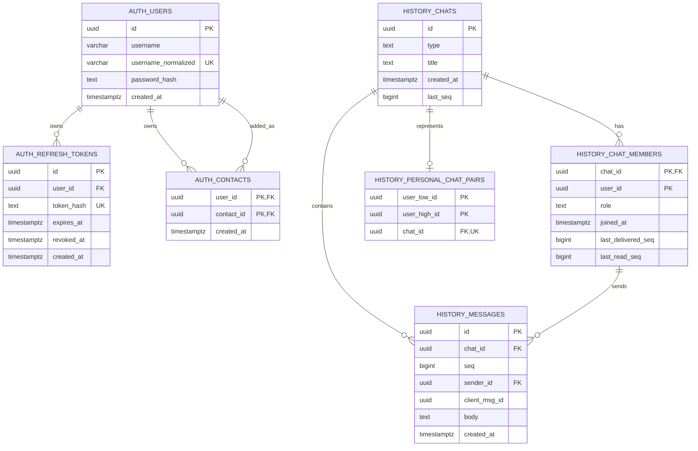

# ER-диаграмма

Источник: [схема БД](schema.md), [T11](https://github.com/messenger-go-team/messenger/issues/11).

UUID-поля `history.chat_members.user_id`, `history.personal_chat_pairs.*` и
`history.messages.sender_id` логически ссылаются на `auth.users`, но не имеют
внешних ключей между сервисными схемами. Подробнее - в [схеме БД](schema.md).

Составные ключи, которые нельзя трактовать как уникальность отдельных полей:

- `auth.contacts`: PK `(user_id, contact_id)`.
- `history.chat_members`: PK `(chat_id, user_id)`.
- `history.personal_chat_pairs`: PK `(user_low_id, user_high_id)`,
  CHECK `user_low_id < user_high_id`; `chat_id` уникален отдельно.
- `history.messages`: UNIQUE `(chat_id, seq)` и
  `(chat_id, sender_id, client_msg_id)`; FK `(chat_id, sender_id)` ссылается
  на `history.chat_members(chat_id, user_id)`.

Кардинальности показывают ограничения связей БД. Сервис дополнительно
гарантирует: у личного чата ровно два участника и одна каноническая пара,
созданные в одной транзакции. Поле `type` допускает будущие группы, поэтому
общая связь chats/members не задаёт фиксированное число участников.
